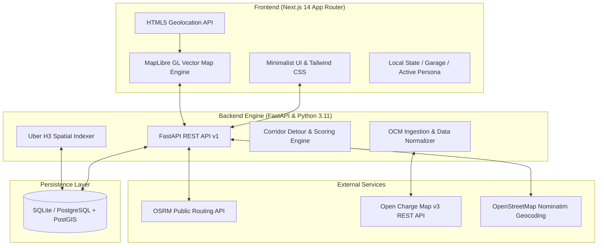
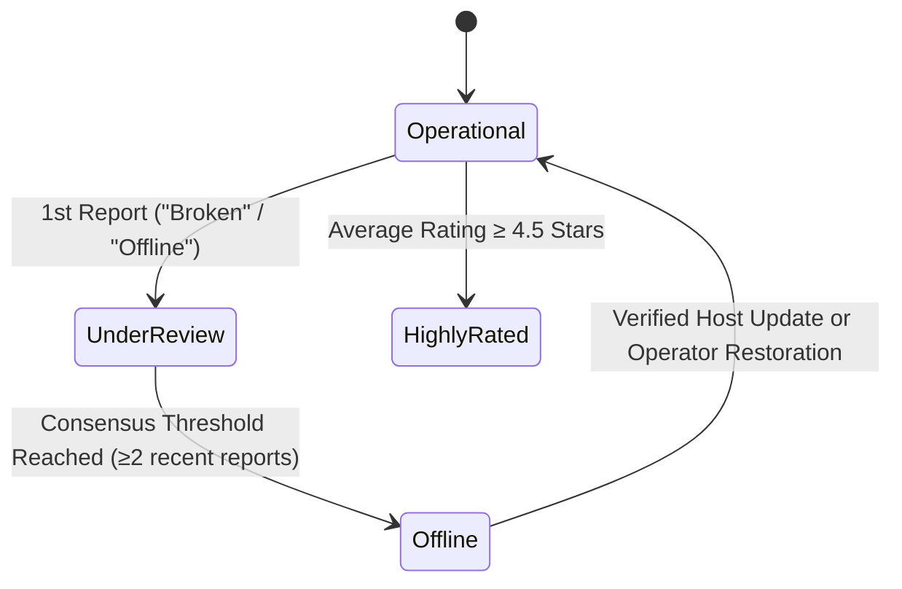

# Zoltraak System Architecture & Technical Specifications

This document outlines the architecture, spatial indexing strategies, corridor routing algorithms, data models, and real-time state synchronization in the **Zoltraak** EV charging navigation ecosystem.

---

## 1. System Overview

Zoltraak is built as a decoupled, high-performance web application designed for EV drivers and charging hosts across India:



---

## 2. Uber H3 Spatial Indexing Architecture

Zoltraak uses the **Uber H3 Discrete Global Grid System** to partition geographical space into regular hexagonal cells. This provides significant advantages over traditional bounding-box or radial distance queries:

1. **Equidistant Neighbors:** Unlike square grids where diagonal neighbors are $\sqrt{2}$ times further away, all 6 neighbors of an H3 hexagon share identical centroid distances.
2. **Hierarchical Tessellation:** Higher resolution hexagons nest cleanly into coarser resolutions, enabling dynamic level-of-detail (LOD) aggregation as the user zooms in or out on the map.
3. **Constant-Time Invariant Indexing:** Spatial lookups convert GPS coordinates $(lat, lon)$ into 64-bit integer H3 indices, enabling $O(1)$ hashing and lightning-fast database index matching.

### Resolution Hierarchy

| H3 Resolution | Hexagon Edge Length | Hexagon Area | Zoom Level Range | Typical Zoltraak Use Case |
|---|---|---|---|---|
| **Res 6** | ~3.23 km | ~36.1 km² | Zoom $\le 7$ | Inter-district highway overviews |
| **Res 7** | ~1.22 km | ~5.16 km² | Zoom $8 - 10$ | City-wide cluster density & regional views |
| **Res 8** | ~461 m | ~0.74 km² | Zoom $11 - 13$ | Standard neighborhood & corridor station search |
| **Res 9** | ~174 m | ~0.10 km² | Zoom $\ge 14$ | Micro-neighborhood and precise street block radius |

### Dynamic Grid Algorithm

When the user moves or zooms the interactive map:
1. The frontend calculates the visible map viewport bounding box: $[min\_lon, min\_lat, max\_lon, max\_lat]$.
2. The current zoom level determines the appropriate H3 resolution:
   $$\text{Resolution} = \begin{cases} 6 & \text{if } z < 8 \\ 7 & \text{if } 8 \le z < 11 \\ 8 & \text{if } 11 \le z < 14 \\ 9 & \text{if } z \ge 14 \end{cases}$$
3. The backend calculates the covering H3 cells, queries station counts per cell, and returns GeoJSON `FeatureCollection` containing polygon coordinates and metadata (`station_count`, `density_tier`, `centroid`).

---

## 3. Corridor Detour & Optimal Charging Algorithm

When an EV driver requests a route from **Point A** to **Point B**, standard navigation engines find the shortest or fastest path without considering charging stops or battery limits. Zoltraak implements a **corridor-aware charging detour planner**:

```
[Start A] =======================> [Destination B]
                    \   Detour   /
                     \    to    /
                      [Station]
```

### Corridor Search Pipeline:

1. **Direct Path Interpolation:** Query OSRM to generate the direct polyline between origin and destination.
2. **Corridor Bounding Buffer:** Sample equidistant waypoints along the polyline (every 5–10 km).
3. **H3 Candidate Retrieval:** For each waypoint, generate an H3 disk (k-ring $k=2$ or $3$) to retrieve all candidate charging stations within a 15 km corridor.
4. **Detour Cost Scoring Function:** Each candidate station $S$ is evaluated using a composite cost function:

$$\text{Score}(S) = w_d \cdot D_{\text{detour}}(S) + w_p \cdot P_{\text{power}}(S) + w_r \cdot (5.0 - R_{\text{rating}}(S)) + w_q \cdot Q_{\text{queue}}(S)$$

Where:
* $D_{\text{detour}}(S) = \text{Dist}(A, S) + \text{Dist}(S, B) - \text{Dist}(A, B)$ (Extra distance required to stop at station $S$)
* $P_{\text{power}}(S)$: Penalty inverse to charger power (DC fast chargers score higher than AC slow chargers).
* $R_{\text{rating}}(S)$: Crowdsourced rating (1.0 to 5.0 stars).
* $Q_{\text{queue}}(S)$: Real-time vehicle queue length reported by drivers or operators.
* $w_d, w_p, w_r, w_q$: Tuned weights balancing detour time versus charging speed and reliability.

5. **Multi-Stop Route Assembly:** If the trip length exceeds the estimated single-charge range based on the user's vehicle battery capacity (e.g., Tata Nexon EV 40.5 kWh, MG ZS EV 50.3 kWh) and current State of Charge (SoC), the route is partitioned into optimal legs with recommended charging stops.

---

## 4. Peer-to-Peer Community Home Charging Network

In addition to commercial fast-charging stations from Open Charge Map, Zoltraak features a dedicated **Peer-to-Peer (P2P) Residential Charger Network**:

### Key Characteristics:
* **Standard Fixed Tariff:** Fixed at **₹11.50 per kWh** (matching subsidized domestic residential and green tariff brackets in Kerala).
* **Power Levels:** Residential AC wallboxes (typically 3.3 kW single-phase or 7.4 kW / 11 kW 3-phase Type 2 AC chargers).
* **Synthetic Geographic Distribution:** 171+ verified synthetic home hosts distributed across all 14 districts of Kerala (Thiruvananthapuram, Kochi/Ernakulam, Kozhikode, Thrissur, Kollam, Alappuzha, Kottayam, Kannur, Palakkad, Malappuram, Wayanad, Idukki, Kasaragod, Pathanamthitta).
* **Live Status & Queue Tracking:** Homeowners can toggle their charger between `available`, `busy`, and `offline`, and update their driveway queue status.
* **Distinct Visual Encoding:** Rendered with distinct **Electric Royal Blue** (`#2563eb`) markers and white borders to immediately distinguish them from commercial green stations (`#10b981`).

---

## 5. Crowdsourced Reliability & Outage Detection

EV charging infrastructure often suffers from broken connectors, blocked parking spots (ICE-ing), or offline grid connections. Zoltraak solves this through crowdsourced community intelligence:

### State Machine:



* **Driver Reports:** Drivers can submit reports (`operational`, `broken`, `busy`, `inaccessible`, `wrong_info`) alongside star ratings (1–5) and commentary.
* **Instant Outage Propagation:** When a station receives an `unavailable` or `broken` report, its operational status is automatically adjusted, alerting other drivers and recalculating active routes to avoid non-functioning chargers.

---

## 6. Security & Data Integrity

* **Zero Plaintext Credentials:** API keys and sensitive environment variables are strictly managed via `.env` and Pydantic `BaseSettings`.
* **Idempotent Ingestion:** Open Charge Map ingestion runs compare `ocm_id` and timestamps, performing non-destructive upserts that preserve local crowdsourced annotations, ratings, and custom status overrides.
* **Resilient Offline Fallback:** If OSRM or Nominatim remote services experience latency or network outages, Zoltraak gracefully falls back to local Euclidean/Haversine corridor approximations, ensuring zero UI crashes.
